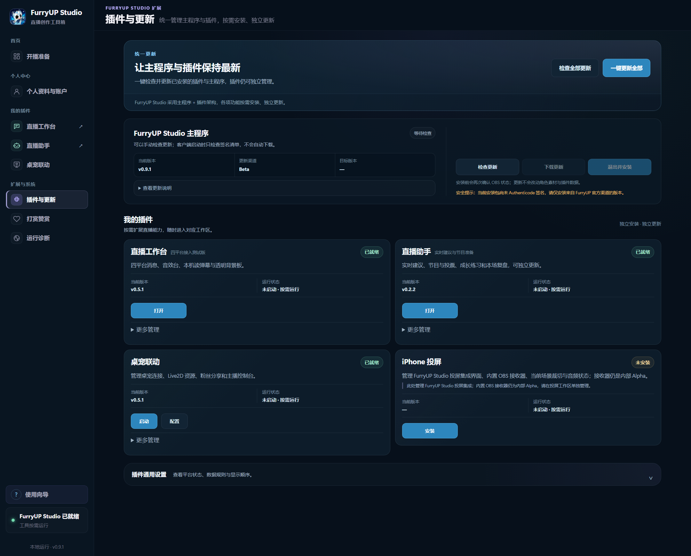
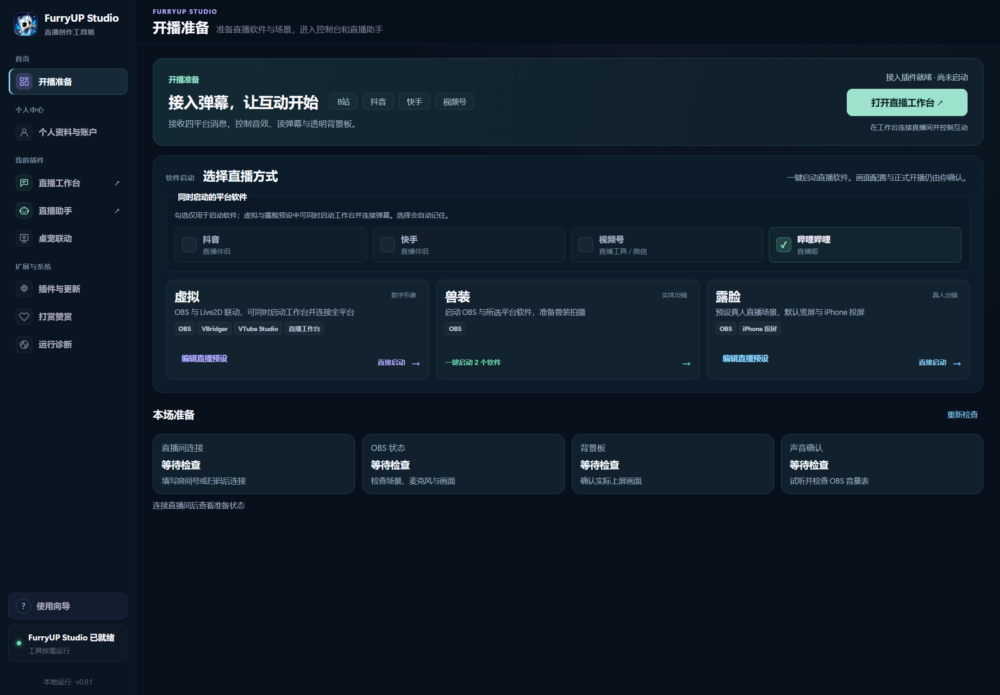
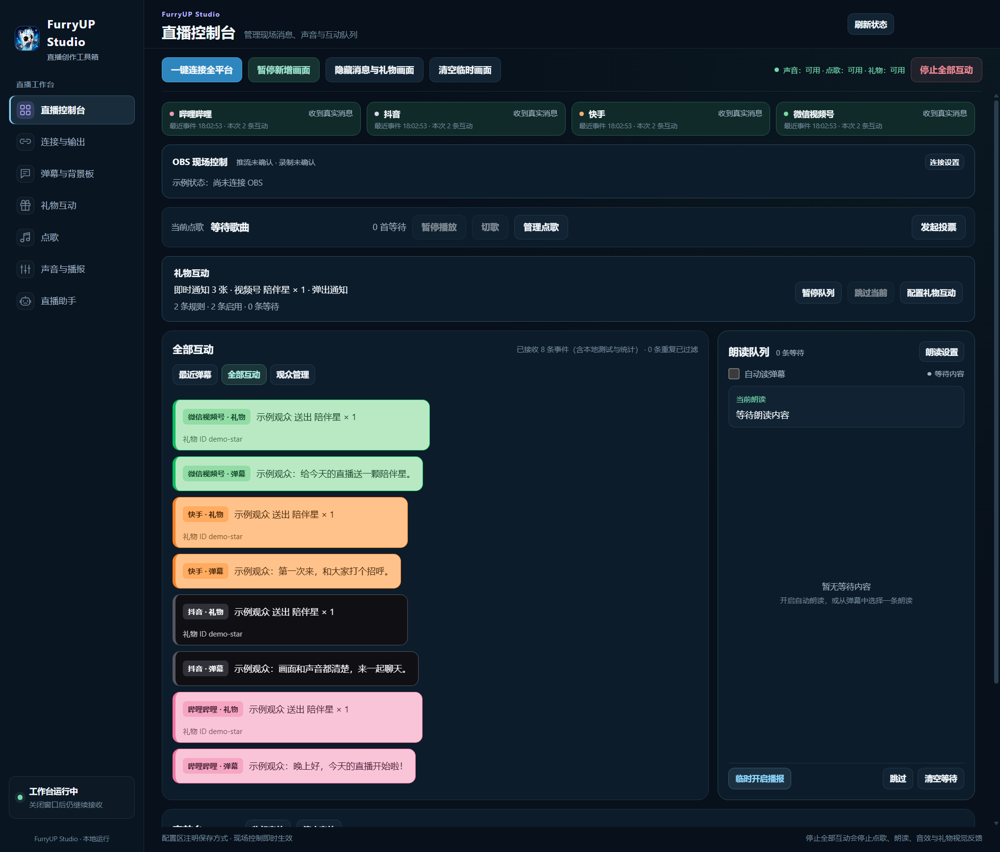
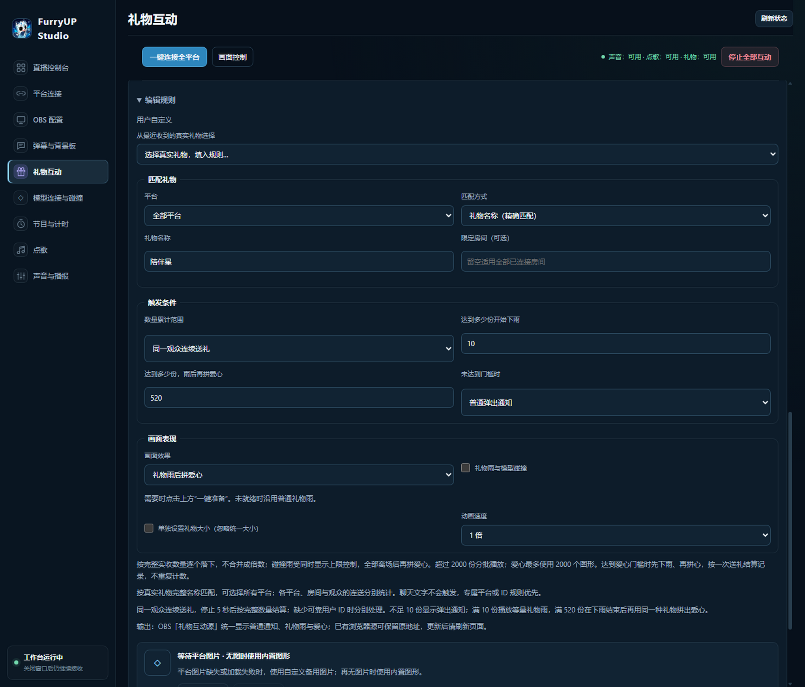
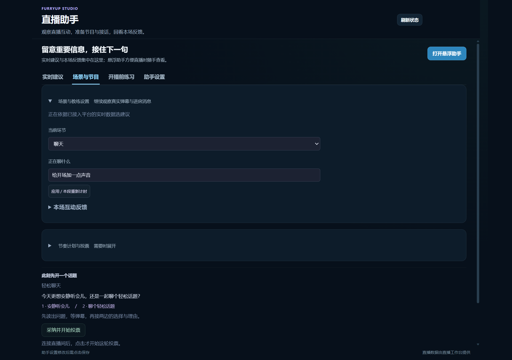
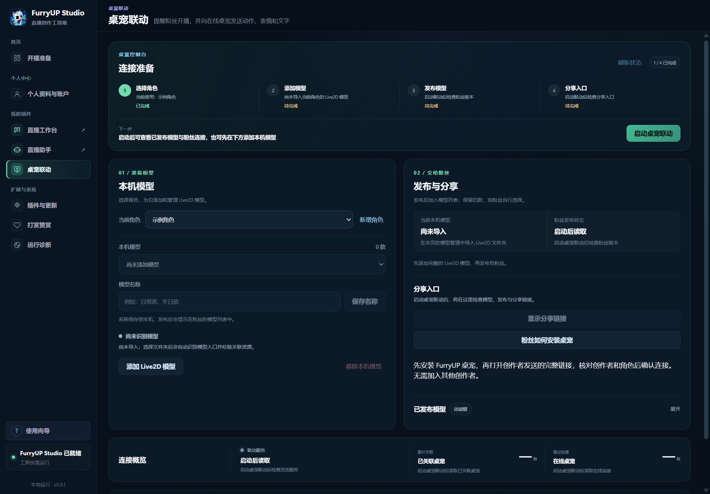

  

<h1 align="center">FurryUP Studio</h1>

<strong>把四平台弹幕、礼物与现场互动集中在一个工作台。</strong>

主程序 + 独立插件 · 主播端官方安装包、软件介绍与重要更新

  <a href="https://frostynight.top/furryup">官方网站</a> ·
  <a href="https://github.com/frostynight-furry/furryup-studio-releases/releases/tag/v0.9.1">最新版本</a> ·
  <a href="CHANGELOG.md">重要更新</a> ·
  <a href="https://github.com/frostynight-furry/furryup-desktop-pet-releases">粉丝端桌宠</a>

## 下载 FurryUP Studio

当前版本：**0.9.1**

| 适用系统 | 官方安装包 |
| --- | --- |
| **Windows 10 / Windows 11，64 位（x64）** | **[下载 FurryUP Studio 安装包](https://github.com/frostynight-furry/furryup-studio-releases/releases/download/v0.9.1/FurryUPStudio-Setup-0.9.1.exe)** |

[查看本版说明与 SHA-256 校验值 →](https://github.com/frostynight-furry/furryup-studio-releases/releases/tag/v0.9.1)

下载后退出正在运行的 FurryUP Studio，再运行安装包。首次使用请先配置需要的直播工具、平台连接和插件。安装包尚未进行 Windows 代码签名，Windows 可能显示“未知发布者”；请从本仓库或官网获取，并核对发布页的校验值。

## 可以做什么

| 功能 | 使用方式 |
| --- | --- |
| **主程序 + 插件架构** | 主程序统一管理账户与工作区，直播工作台、直播助手、桌宠联动按需使用，支持独立安装、启停、更新和回滚。 |
| **插件与更新** | 在一个页面检查主程序与插件更新，一键更新已安装插件并下载主程序更新，逐项查看进度与结果。 |
| **四平台直播工作台** | 同时接入哔哩哔哩、抖音、快手和视频号，在同一工作台查看各平台连接状态，以及收到的弹幕和礼物消息。 |
| **特定礼物规则** | 为指定平台与礼物设置反馈，按单次送礼、连送或累计数量触发效果，并管理等待队列。 |
| **全局礼物特效** | 为其他礼物配置通用反馈，通过 OBS Studio 礼物互动源展示通知、礼物雨、爱心成形等效果。 |
| **声音与现场控制** | 使用弹幕朗读、欢迎与礼物感谢、音效台和点歌队列，调整声音、暂停或跳过播放。 |
| **直播助手** | 查看互动提醒、话题建议、礼物节目安排、投票和本场复盘，由主播决定是否采纳与执行。 |
| **开播准备** | 保存平台与出镜方式，检查并启动 OBS Studio、平台直播工具等本机软件，减少重复准备。 |
| **桌宠联动** | 管理角色与 Live2D 模型，为同一角色添加、选择和独立命名多款模型，明确发布后分享给粉丝。 |
| **个人中心与语言** | 管理账户头像和名字、使用邮箱验证码登录或绑定账户；支持简体中文与 English 界面切换。 |

四个平台可以同时连接；各平台提供的消息种类、字段与投递情况不同，实际显示以平台返回和客户端连接状态为准。各平台需分别完成房间或登录配置。FurryUP Studio 聚合收到的互动消息，正式推流仍需在对应平台软件中确认。

### 一个主程序，按需使用插件

FurryUP Studio 采用**主程序 + 独立插件**架构：主程序提供统一的账户、工作区与插件管理，直播工作台、直播助手和桌宠联动分别承担各自的功能。常规插件更新可以独立完成，无需每次重新安装整个主程序。

新版**插件与更新**将更新总览和主程序更新放在页面顶部，下面集中管理各个插件。点击“检查全部更新”查看可用版本，或点击“一键更新全部”，依次更新已有插件并准备主程序安装包。主程序下载并校验完成后，点击“退出并安装”完成升级；安装前保留 OBS Studio 直播与录制状态检查。

每个更新项目都有独立状态；个别插件失败时继续处理其余项目，可查看原因后重试。更新保留已验证的旧版本与已有的停用、卸载选择，不自动安装未安装的插件或启用已停用的插件。直播助手和消息采集独立运行，更新或停用助手不会中断直播工作台接收消息。

### 四平台消息与礼物互动

直播控制台集中显示平台状态、最近弹幕、朗读队列、点歌和礼物互动。针对特定礼物设置规则后，可以安排对应的通知或动画；其他礼物使用通用规则。礼物视觉反馈、音效与语音感谢分别配置，可按直播需要启停。

将礼物互动源添加到 OBS Studio 的浏览器源后，可显示礼物通知、礼物雨和爱心效果。画面与触发数量按规则配置；本地预览使用示例数据，正式反馈依据实际收到的礼物事件。外部直播软件需事先安装和配置，开播前请确认画面、模型、音频和推流设置。

例如，可选择“同一观众连送满 10 份播放礼物雨、满 520 份雨后拼爱心”的推荐规则，再按自己的直播节奏调整。此类规则需要主播填入草稿并明确保存，并非安装后自动为所有礼物启用。“全局”表示可为全部平台或全部礼物配置通用反馈，不会跨平台混合计数；同一观众连送按平台、房间、观众与礼物种类分别统计。

直播工作台启动后会在后台检查官方推荐更新，也可手动检查。检查只更新可选推荐，不会覆盖已保存的规则；填入草稿后仍由主播明确保存，才会生效。

### 让助手整理信息，保留自己的节奏

直播助手提供实时建议与复盘入口。建议先展示给主播；问题和投票需由主播明确采纳或开始后才进入 OBS Studio。在线建议需要主动发起，并使用本机已登录 Codex 账户的可用额度。停止助手不会中断直播工作台的消息采集，原有记录继续保留。

联网语音需要网络连接，在线点歌需要配置兼容的音乐服务。

### 把角色陪伴延续到直播之外

主播与角色创作者使用 FurryUP Studio 管理角色和模型，准备好后再明确发布或同步给粉丝。粉丝使用独立的 **FurryUP 桌宠**，通过分享链接确认下载，并在自己的桌面上选择角色模型。两端分别安装、分别更新。

启动软件或恢复会话不会自动发布本机模型。公开分享前需要连接账户，并确认拥有模型及相关素材的分发权限。

## 界面预览

以下截图来自 0.9.1 的实际界面，使用示例状态展示功能；不代表正在连接真实直播间。

**插件与更新**

**开播准备**

**四平台直播工作台**

**礼物规则与视觉反馈**

**直播助手**

**桌宠联动**

## 本次更新 · 0.9.1

- **修正升级目标：** 当前版本已是最新或高于服务器版本时，不再把旧版本显示为升级目标或使用升级箭头，保留禁止降级检查。
- **同步在线更新：** 软件内更新支持三段数字版本，GitHub 安装包和软件内更新清单同步到 0.9.1。
- **一致的下载内容：** 两个更新渠道使用同一份安装包，并核对真实下载内容的大小与 SHA-256。
- **更新行为保持明确：** 一键更新已安装插件并下载主程序；安装包准备好后，由主播选择“退出并安装”，继续检查 OBS Studio 直播与录制状态。
- **插件版本保持不变：** 直播工作台 0.5.1、直播助手 0.2.2、桌宠联动 0.5.1、iPhone 投屏预览 0.4.1。

[查看历史重要更新 →](CHANGELOG.md)

## 关于本仓库

本仓库公开**安装包、软件介绍、更新记录和必要展示图片**。FurryUP Studio 主程序与其他插件源码不公开。独立 OBS 原生投屏接收器的[源码预览](https://github.com/frostynight-furry/furryup-airplay-receiver)在单独仓库公开；该仓库目前不提供经过公开发行验证的接收器二进制。

GitHub 自动生成的 **Source code** 压缩包只包含对应标签下的介绍文档与展示图片。安装软件请下载上面的 **EXE**。

本包不包含 iPhone 投屏内部接收器，该功能仍处于内部 Alpha。GitHub 与软件内更新同步发布，提供相同版本和相同内容的安装包。主程序和独立插件分别检查版本，可在“插件与更新”中查看。

FurryUP 后续版本统一使用三段数字：维护更新递增末位、功能更新递增中位、重大更新递增首位，历史编号保留。

品牌、图标与展示图片仅用于产品介绍，不代表开放源码或授予额外素材使用许可。

发行主体：苏州工业园区夜霜文化创意工作室（个体工商户）

官方网站：[frostynight.top/furryup](https://frostynight.top/furryup)

支持邮箱：[yeshuang@frostynight.cn](mailto:yeshuang@frostynight.cn)

反馈问题时，请附上 FurryUP Studio 版本、Windows 版本、复现步骤和脱敏诊断信息。
