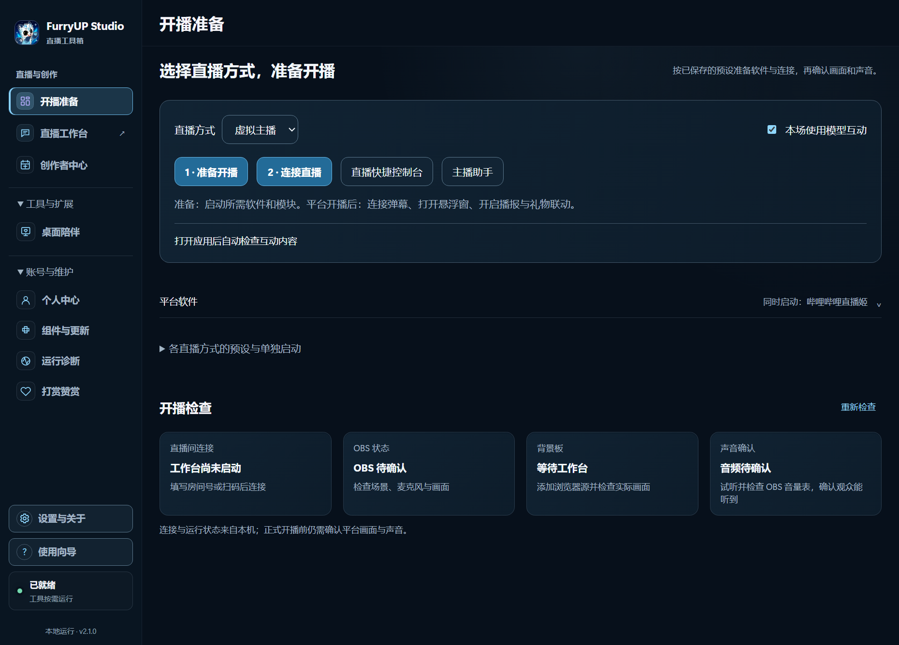
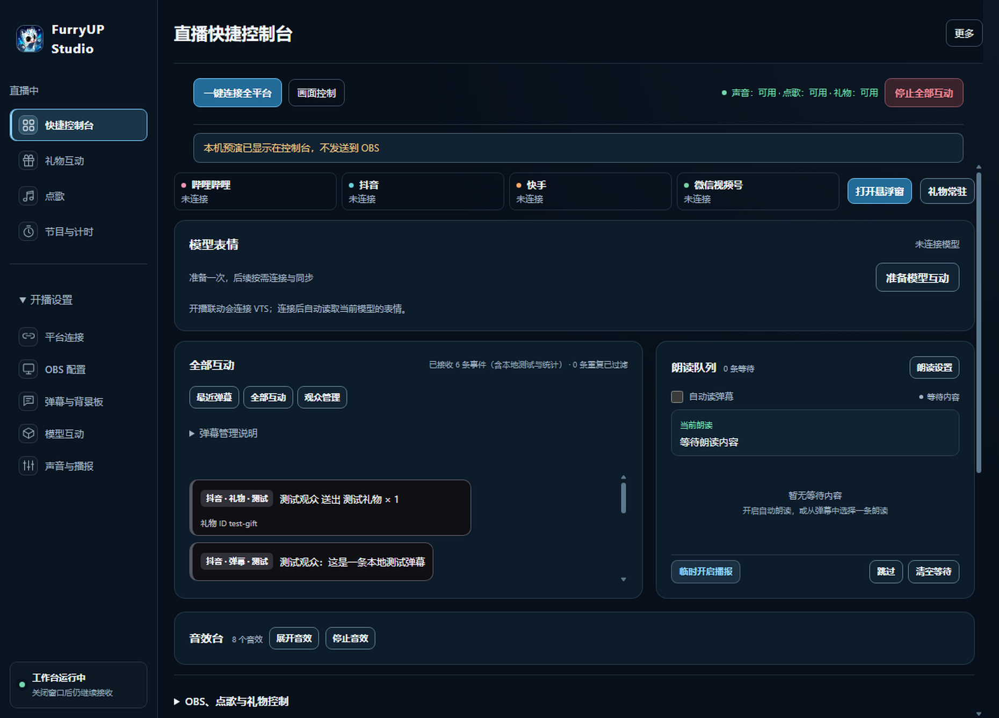
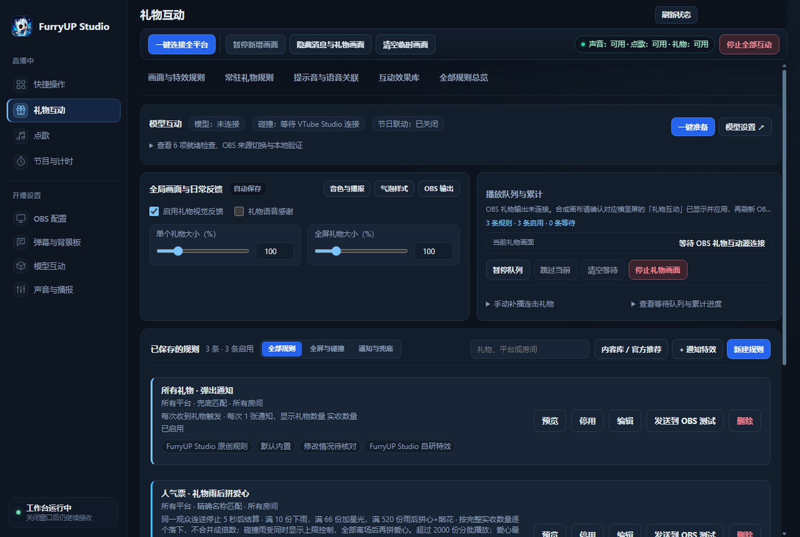
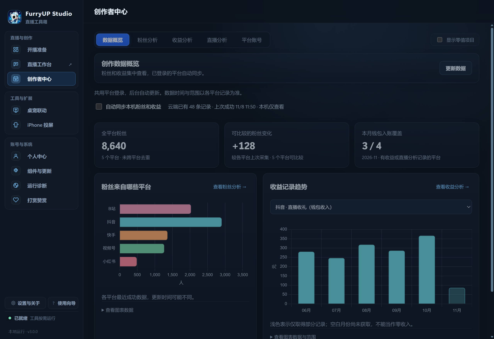
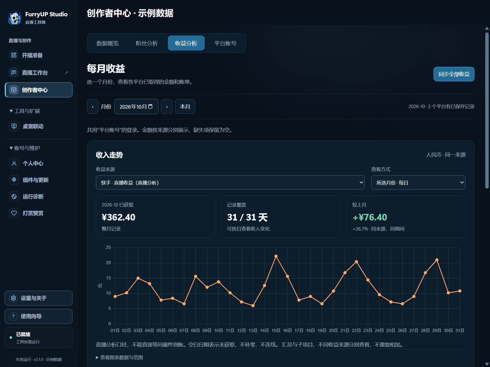
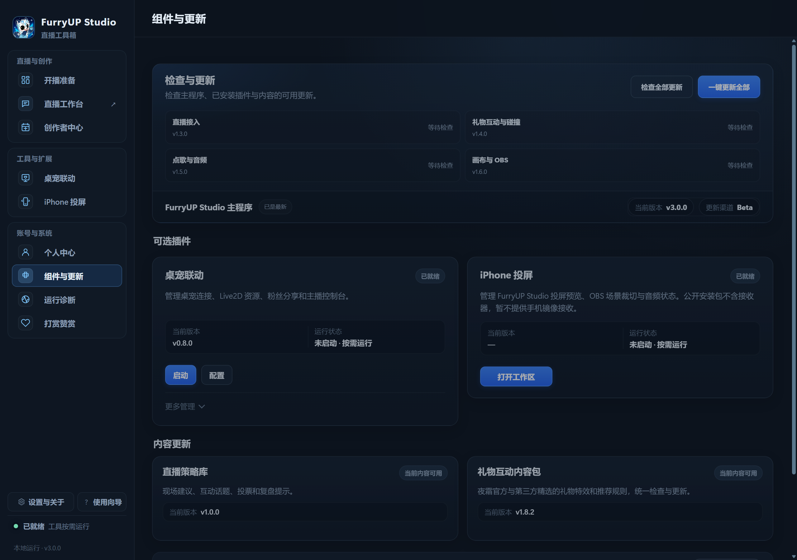

<p align="center"></p>

# FurryUP Studio 主播端

FurryUP Studio 把开播准备、直播互动和播后复盘放在一个 Windows 工作台。主播可以在同一处查看 B站、抖音、快手和视频号的弹幕与礼物，用 OBS 展示互动效果，也可以在下播后对照各平台的粉丝变化与收益记录。

**[下载 2.1.0 安装包 · Windows 10 / 11 x64](https://github.com/frostynight-furry/furryup-studio-releases/releases/download/v2.1.0/FurryUPStudio-Setup-2.1.0.exe)**　·　[本版说明与 SHA-256](https://github.com/frostynight-furry/furryup-studio-releases/releases/tag/v2.1.0)　·　[官方网站](https://frostynight.top/furryup)

## 第一次开播

1. **开播准备**　选择出镜方式和这次要用的平台，点击「准备开播」。按页面提示检查 OBS 画面、麦克风和模型。
2. **直播工作台**　在对应平台确认开播后，点击「连接直播」。快捷控制台显示各平台的连接状态、最近互动和朗读队列，也能直接打开悬浮窗。
3. **创作者中心**　按需登录平台账号，查看粉丝和收益。图表标出统计来源、单位和记录范围，平台未返回的日期保留空白。



## 直播中

四个平台可分别连接。某个平台需要扫码或重新授权时，可以在「平台账号」处理。可收到的消息类型和观众指标由各平台提供。



<a id="gift-interaction-and-model-collision"></a>

**礼物互动与模型碰撞**　可以按礼物种类、数量或连击设置反馈。先在「礼物互动」里本机试播，再决定是否启用。搭配支持实时轮廓的 VTube Studio，可为自己的模型手选碰撞部位，让礼物雨随模型轮廓落下，最后由 OBS 合成画面。

<details>
<summary>查看礼物效果库</summary>



</details>

## 下播后看数据

「数据概览」并排显示粉丝分布与收益趋势。2.1.0 支持在同一个 FurryUP Studio 账号下查看已同步的创作数据。本机上传默认关闭，需要时在创作者中心开启「自动同步本机粉丝和收益」。



在「收益分析」里选择月份、平台和来源，可查看每日记录或近六个月趋势。视频号累计收入、可提现余额与月收益分开展示。视频号逐日、逐月分成明细以及抖音钱包账单仍有接入限制。各来源分别统计，直播分析金额以平台最终结算为准。

<details>
<summary>查看每日收益图和记录覆盖范围</summary>



</details>

## 安装与组件

升级前请正常退出正在运行的 FurryUP Studio，再运行 EXE。公开安装包尚未进行 Windows 代码签名，Windows 可能显示「未知发布者」。可在 PowerShell 中运行下列命令，并与本版 Release 的 SHA-256 对照。

```powershell
Get-FileHash .\FurryUPStudio-Setup-2.1.0.exe -Algorithm SHA256
```

「组件与更新」列出直播接入、礼物互动、点歌音频、画布与 OBS 的版本和更新状态。主播助手与桌宠联动按需使用。iPhone 投屏随包提供界面预览，接收端未包含在公开安装包中。

<details>
<summary>查看组件与更新界面</summary>



</details>

六张截图均取自 2.1.0 公开安装包的运行界面。控制台消息来自本机预演，图表数值为演示数据。

本仓库提供安装包、产品介绍和更新记录。主程序、界面与专属互动内容保持闭源。GitHub 自动生成的 Source code 压缩包仅含本仓库的文档与展示图片。[历史更新](CHANGELOG.md)

发行主体为苏州工业园区夜霜文化创意工作室（个体工商户）。
