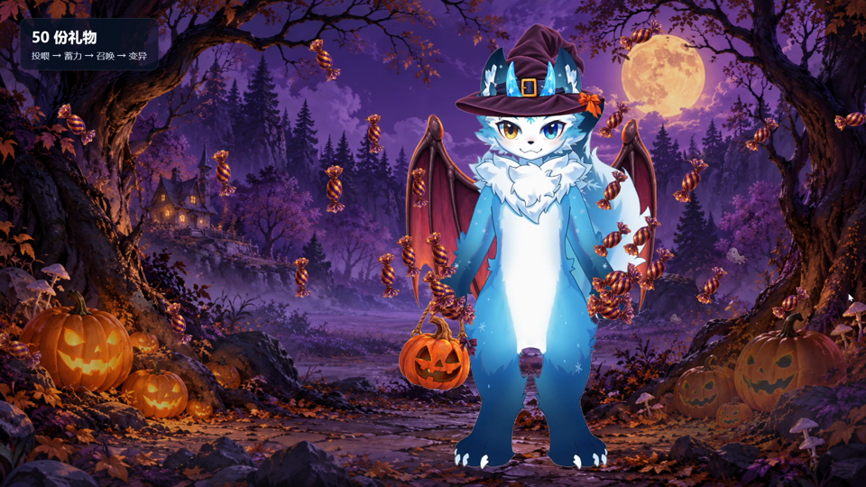
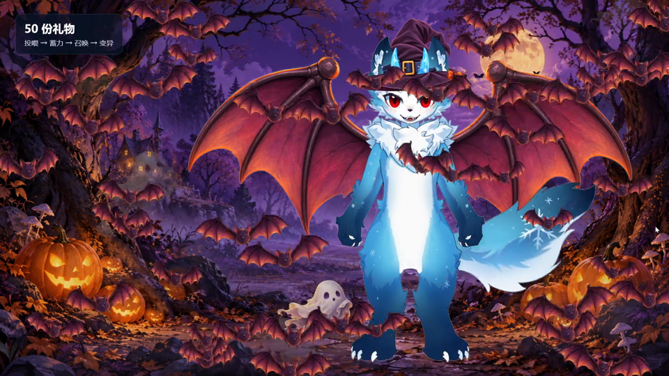

<p align="center"></p>

# FurryUP Studio

FurryUP Studio 把开播准备、直播互动和播后复盘放在一个 Windows 工作台。主播可以在同一处查看 B站、抖音、快手和视频号的弹幕与礼物，用 OBS 展示互动效果，也可以在下播后对照各平台的粉丝变化与收益记录。

| 客户端 | 当前版本 | 下载 |
| --- | --- | --- |
| Windows 10 / 11 x64 | 2.1.0 稳定版 | [EXE 安装包](https://github.com/frostynight-furry/furryup-studio-releases/releases/download/v2.1.0/FurryUPStudio-Setup-2.1.0.exe) · [版本说明](https://github.com/frostynight-furry/furryup-studio-releases/releases/tag/v2.1.0) |
| Android 手机 / 平板（8.0+） | 0.4.0 测试版 | [APK 安装包](https://github.com/frostynight-furry/furryup-studio-releases/releases/download/android-v0.4.0/FurryUP-Studio-Android-0.4.0-test.apk) · [说明与校验值](https://github.com/frostynight-furry/furryup-studio-releases/releases/tag/android-v0.4.0) |

[万圣节互动演示](#万圣节礼物互动) · [官方网站](https://frostynight.top/furryup)

## 手机与平板

Android 是 FurryUP Studio 的移动客户端，可独立使用。与 Windows 使用同一品牌及 FUS 账号，分别维护版本与安装包；Android 使用 `android-v*` 预发布标签。

0.4.0 重新整理了整个 App：

- **首页**：准备本场兽设、监看平台与直播间，突出“开始直播”。
- **创作者中心**：优先查看概览、粉丝分布与独立来源的收益趋势；账号授权、采集和同步放入二级页面。
- **我的**：管理 FurryUP 账号、多套兽设、直播间与平台、多设备数据、外观及帮助。
- 手机底部导航、宽屏侧栏与适合宽度的分栏内容；二级返回栏固定在顶部。深浅主题、透明兽设与桌面角色入口保留。
- 可选择全部已支持的平台，窗口只显示一路画面，底部四按钮切换；已成功连接来源的弹幕与礼物继续合并。应用负责监看，推流仍由平台或电脑负责。
- 多设备数据每天自动同步一次，手动刷新立即执行；本机上传默认关闭。零值明细默认收起，真实零值、缺失日期、负值更正与不同单位分别保留。

沿用原安卓发行签名，0.4.0 的版本码为11，支持从0.3.2覆盖升级。手机/平板模拟器和受控升级已验证。B站公开房间的握手及画面已复测；抖音、快手、视频号真实授权与长期运行，以及 FUS 真实双设备数据和共享平台登录仍待联调，不能把登录 FUS 等同于已自动连接四个平台。

以下为实际原生界面；粉丝和收益为合成示例：


<details>
<summary>查看创作者中心、手机及深色布局</summary>


| 手机首页 | 手机“我的” |
| --- | --- |
|  |  |


</details>

## 第一次开播

1. **开播准备**　选择出镜方式和这次要用的平台，点击「准备开播」。按页面提示检查 OBS 画面、麦克风和模型。
2. **直播工作台**　在对应平台确认开播后，点击「连接直播」。快捷控制台显示各平台的连接状态、最近互动和朗读队列，也能直接打开悬浮窗。
3. **创作者中心**　按需登录平台账号，查看粉丝和收益。图表标出统计来源、单位和记录范围，平台未返回的日期保留空白。


## 直播中

四个平台可分别连接。某个平台需要扫码或重新授权时，可以在「平台账号」处理。可收到的消息类型和观众指标由各平台提供。


<a id="gift-interaction-and-model-collision"></a>

**礼物互动与模型碰撞**　可以按礼物种类、数量或连击设置反馈。先在「礼物互动」里本机试播，再决定是否启用。搭配支持实时轮廓的 VTube Studio，可为自己的模型手选碰撞部位，让礼物雨随模型轮廓落下，最后由 OBS 合成画面。

<details>
<summary>查看礼物效果库</summary>


</details>

### 万圣节礼物互动

**有声演示 · 50 份模拟礼物 · 17.6 秒**

这段视频节选自 2026 年 11 月 1 日夜霜的 VTube Studio 与 OBS 联动预演，配上了最终修订的音效。前置礼物雨过后，糖果飞向双手。钟声响起，南瓜灯亮起，幽灵飘过身旁。灯光淡去后，夜霜变成红瞳，蝙蝠群掠过画面。

https://github.com/user-attachments/assets/77da31ca-e3ed-4c16-97ac-772f43193f05

<details>
<summary>演示音效署名</summary>

幽灵主声采用 Billy_Storm 的录音，片段经剪辑、调速与混音。[ghostly_moan.wav](https://freesound.org/people/Billy_Storm/sounds/164285/) · [CC BY 3.0 许可](https://creativecommons.org/licenses/by/3.0/)

以下录音以 CC0 1.0 提供，演示中使用了剪辑和混音后的片段。[CC0 1.0 说明](https://creativecommons.org/publicdomain/zero/1.0/)

- 糖果落下与糖纸声由 j1987 录制。[糖果](https://freesound.org/people/j1987/sounds/573197/) · [糖纸](https://freesound.org/people/j1987/sounds/573195/)
- 钟声由 hyderpotter 录制，另一层幽灵声由 SirBedlam 录制。[钟声](https://freesound.org/people/hyderpotter/sounds/80290/) · [幽灵声](https://freesound.org/people/SirBedlam/sounds/329519/)
- 蝙蝠叫声由 polymorpheva 录制，振翅声使用了 ani_music 的拟音。[蝙蝠叫声](https://freesound.org/people/polymorpheva/sounds/104205/) · [振翅拟音](https://freesound.org/people/ani_music/sounds/244976/)

</details>


| 开场 · 双手接糖 | 收尾 · 红瞳与蝙蝠群 |
| :---: | :---: |
|  |  |

## 下播后看数据

「数据概览」并排显示粉丝分布与收益趋势。2.1.0 支持在同一个 FurryUP Studio 账号下查看已同步的创作数据。本机上传默认关闭，需要时在创作者中心开启「自动同步本机粉丝和收益」。


在「收益分析」里选择月份、平台和来源，可查看每日记录或近六个月趋势。视频号累计收入、可提现余额与月收益分开展示。视频号逐日、逐月分成明细以及抖音钱包账单仍有接入限制。各来源分别统计，直播分析金额以平台最终结算为准。

<details>
<summary>查看每日收益图和记录覆盖范围</summary>


</details>

## 安装与组件

升级前请正常退出正在运行的 FurryUP Studio，再运行 EXE。公开安装包尚未进行 Windows 代码签名，Windows 可能显示「未知发布者」。可在 PowerShell 中运行下列命令，并与本版 Release 的 SHA-256 对照。

```powershell
Get-FileHash .\FurryUPStudio-Setup-2.1.0.exe -Algorithm SHA256
```

「组件与更新」列出直播接入、礼物互动、点歌音频、画布与 OBS 的版本和更新状态。主播助手与桌宠联动按需使用。iPhone 投屏随包提供界面预览，接收端未包含在公开安装包中。

<details>
<summary>查看组件与更新界面</summary>


</details>

六张软件界面截图取自 2.1.0 公开安装包。控制台消息来自本机预演，图表数值为演示数据。

本仓库提供安装包、产品介绍和更新记录。主程序、界面与专属互动内容保持闭源。GitHub 自动生成的 Source code 压缩包仅含本仓库的文档与展示图片。[历史更新](CHANGELOG.md)

发行主体为苏州工业园区夜霜文化创意工作室（个体工商户）。
