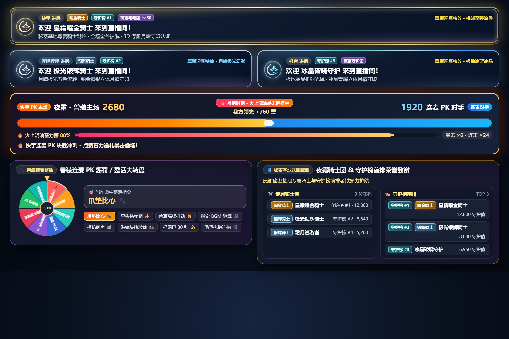
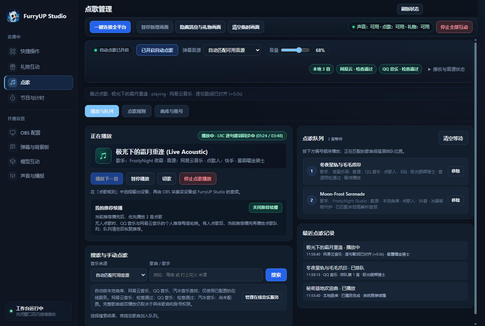
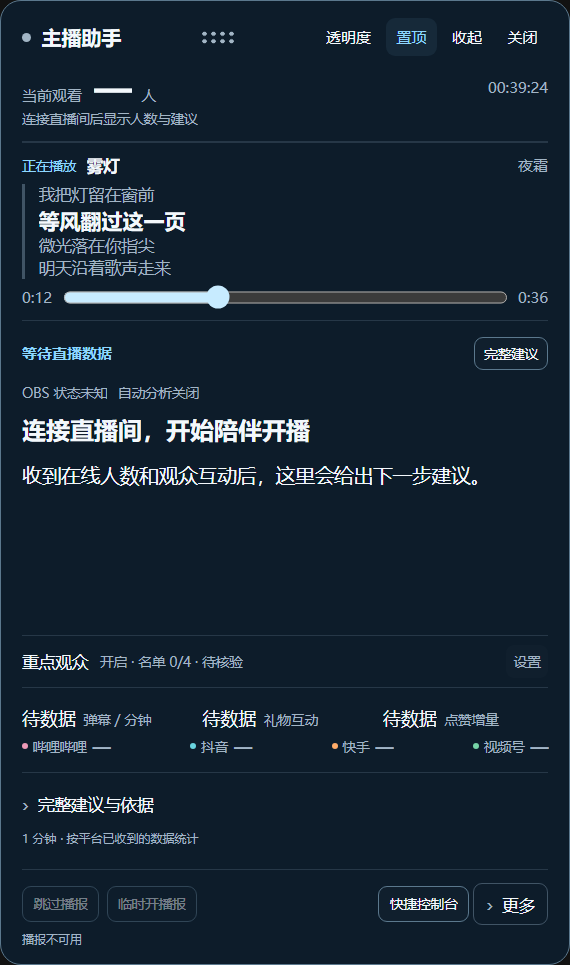
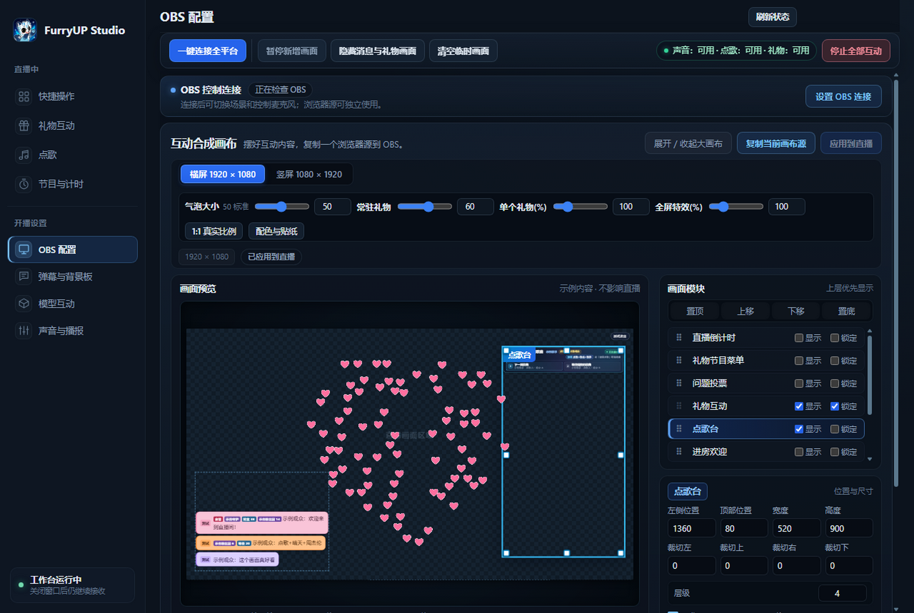
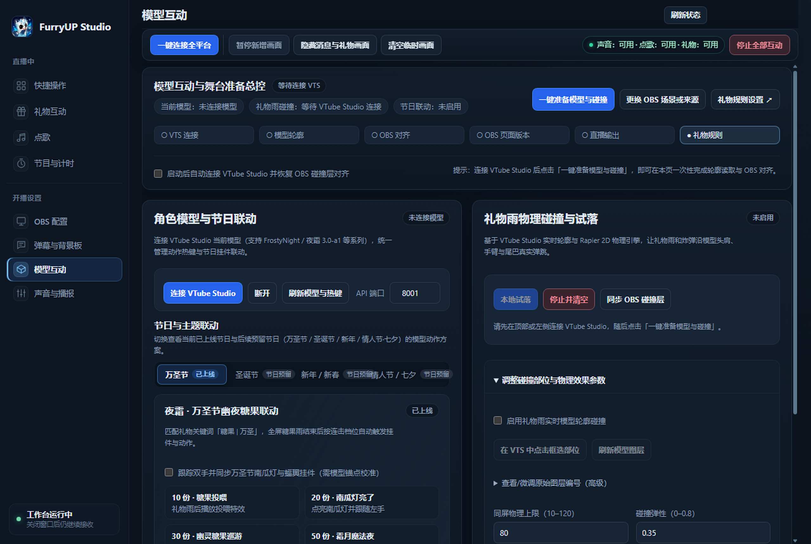
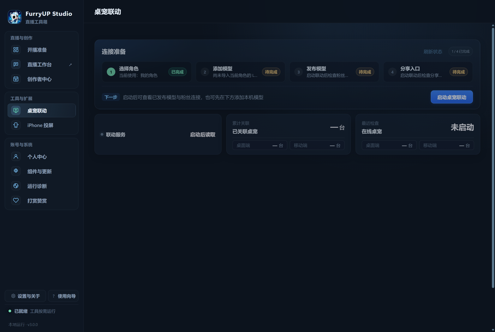

<p align="center"></p>

# FurryUP Studio 3.0

FurryUP Studio 把**开播准备**、**多平台直播互动**、**OBS 舞台合成与骑士团入场特效**、**双栏点歌广播台**和**播后创作者数据复盘**整合在一个 Windows 桌面工作台。主播可以在同一处连接 B站、抖音、快手和微信视频号，实时处理弹幕、礼物、点歌与连麦 PK 整活，并在下播后对照各平台的粉丝变化与收益走势。

| 客户端 | 当前版本 | 下载 |
| --- | --- | --- |
| Windows 10 / 11 x64 | **3.0.0 稳定版** | [EXE 安装包](https://github.com/frostynight-furry/furryup-studio-releases/releases/download/v3.0.0/FurryUPStudio-Setup-3.0.0.exe) · [版本说明与校验值](https://github.com/frostynight-furry/furryup-studio-releases/releases/tag/v3.0.0) |
| Android 手机 / 平板（8.0+） | 0.4.0 测试版 | [APK 安装包](https://github.com/frostynight-furry/furryup-studio-releases/releases/download/android-v0.4.0/FurryUP-Studio-Android-0.4.0-test.apk) · [说明与校验值](https://github.com/frostynight-furry/furryup-studio-releases/releases/tag/android-v0.4.0) |

[尊贵骑士团与连麦 PK 特效](#尊贵骑士团入场与连麦-pk-舞台) · [双栏点歌广播台](#点歌管理与双栏广播台) · [开源核心组件](#开源核心组件仓库) · [万圣节礼物互动演示](#万圣节礼物互动) · [官方网站](https://frostynight.top/furryup)

---

## 3.0 全新重构工作台一览

### 1. 开播准备：双出镜模式与两步式开播引导

3.0 重新设计了「开播准备」工作台，支持**虚拟直播**（搭配 VTube Studio 虚拟形象与模型碰撞）与**兽装直播**（摄像头实拍特写、大字弹幕与语音播报）两种出镜预设。通过「`1 · 准备开播` → `2 · 连接直播`」两步式引导，一键拉起 OBS 画面、语音播报和模型联动，并集中预览本场标题与四平台就绪状态。


### 2. 直播工作台：四平台合流与快手连麦 PK 整活总控

「直播工作台」实时合并 B站、抖音、快手与视频号的观众入场、弹幕、礼物、醒目留言与语音朗读队列，并内置全新的 **🔥 快手连麦 PK 整活与火上浇油面板**：

- **连麦 PK 比分横幅与冲刺蓄力条**：实时同步我方与对手比分、PK 倒计时与「最后 30s 双倍冲刺」蓄力条。
- **PK 惩罚 / 福利大转盘**：支持自定义转盘词条（如兽爪比心、角色配音台词、随机连跳、水友点歌等）与舞台一键开转。
- **骑士团与守护榜荣誉顶栏**：自动汇总本场 MVP 贡献榜、守护骑士人数与平台迎宾开关。
- **四平台专属迎宾特效**：按来源平台（快手老铁、抖音伙伴、B站舰长、视频号观众）呈现定制色彩的入场欢迎横幅。


---

<a id="尊贵骑士团入场与连麦-pk-舞台"></a>

## 尊贵骑士团入场与连麦 PK 舞台

3.0 同步升级了跨端统一的**尊贵骑士团入场特效**与 **3D 浮雕「月霜守印」矢量圣徽**，直接由 OBS 浏览器源高帧率渲染：

- **三阶骑士团横幅规制**：
  - **曜金骑士（Gold Tier 1）**：深邃黑金流光底板、双层纯金发丝内框（`inset 0 0 0 2px`）、顶部暖金高光掠影与专属称号胶囊。
  - **银辉骑士（Platinum Silver Tier 2）**：铂银冰蓝极光渐变、冷银高光内框与星辉粒子轨迹。
  - **守护榜 Top（Ice Prism Tier 3）**：冰晶青蓝棱镜框体与守护榜名次徽标。
- **五层 3D 浮雕「月霜守印」徽记**：内置高精度 SVG 矢量圣徽，包含新月主冠、八芒霜星、冷金星环、四角星尘芒点与中央冰蓝菱晶。
- **连麦 PK 舞台同屏联动**：顶部骑士团与守护榜荣誉顶栏、PK 实时比分与冲刺条、右侧八格整活大转盘可与骑士入场弹幕同屏叠加。



---

<a id="点歌管理与双栏广播台"></a>

## 点歌管理与双栏广播台

「点歌管理」升级为左栏常驻播放控台 + 右栏三标签切换的双栏广播台架构：

- **常驻黑胶播放卡与逐句 LRC 歌词**：实时显示当前曲目封面、播放进度条与高对比逐句同步歌词，支持拖动进度条跳转与单曲复播。
- **观众点歌单 · 播放历史 · 我的推荐续播**：观众在弹幕发送「`点歌 歌名`」即可自动排入队列；当点歌队列空闲时，可从「我的推荐」歌单自动随机续播，保持直播间背景音乐不间断。
- **主播助手悬浮窗联动**：升级主程序后，主播助手悬浮窗可同步显示逐句歌词与播放控制。



<details>
<summary>查看主播助手悬浮歌词窗口</summary>



</details>

---

## OBS 互动合成画布与模型舞台总控

### 1. OBS 互动合成画布（16:9 横屏 / 9:16 竖屏）

「OBS 配置 · 互动合成画布」提供所见即所得的多图层舞台编排器，支持 16:9 横屏与 9:16 竖屏一键切换，内置**二十四节气与节日氛围装扮**、连麦 PK 比分挂件、骑士团入场横幅、弹幕流与点歌卡图层，并提供单键复制 OBS 浏览器源地址与本机特效预演。



### 2. 礼物互动、角色模型（`FrostyNight / 夜霜 3.0-a1`）与物理碰撞

支持按礼物种类、数量或连击配置专属反馈。搭配 VTube Studio 与角色模型（`FrostyNight / 夜霜 3.0-a1`），可在「模型互动与舞台准备总控」中检查节气联动换装、校准模型轮廓碰撞部位，并试落礼物雨物理碰撞效果。

| 礼物互动与触发规则 | 模型互动与舞台准备总控 |
| :---: | :---: |
|  |  |

<a id="万圣节礼物互动"></a>

### 万圣节礼物互动实机演示

**有声演示 · 50 份模拟礼物 · 17.6 秒**

这段视频节选自 2026 年 11 月 1 日夜霜（`FrostyNight`）的 VTube Studio 与 OBS 联动预演，配上了最终修订的音效。前置礼物雨过后，糖果飞向双手。钟声响起，南瓜灯亮起，幽灵飘过身旁。灯光淡去后，夜霜变成红瞳，蝙蝠群掠过画面。

https://github.com/user-attachments/assets/77da31ca-e3ed-4c16-97ac-772f43193f05

<details>
<summary>查看万圣节实机截图与演示音效署名</summary>


| 开场 · 双手接糖 | 收尾 · 红瞳与蝙蝠群 |
| :---: | :---: |
|  |  |

幽灵主声采用 Billy_Storm 的录音，片段经剪辑、调速与混音。[ghostly_moan.wav](https://freesound.org/people/Billy_Storm/sounds/164285/) · [CC BY 3.0 许可](https://creativecommons.org/licenses/by/3.0/)

以下录音以 CC0 1.0 提供，演示中使用了剪辑和混音后的片段：[CC0 1.0 说明](https://creativecommons.org/publicdomain/zero/1.0/)
- 糖果落下与糖纸声由 j1987 录制：[糖果](https://freesound.org/people/j1987/sounds/573197/) · [糖纸](https://freesound.org/people/j1987/sounds/573195/)
- 钟声由 hyderpotter 录制，另一层幽灵声由 SirBedlam 录制：[钟声](https://freesound.org/people/hyderpotter/sounds/80290/) · [幽灵声](https://freesound.org/people/SirBedlam/sounds/329519/)
- 蝙蝠叫声由 polymorpheva 录制，振翅声使用了 ani_music 的拟音：[蝙蝠叫声](https://freesound.org/people/polymorpheva/sounds/104205/) · [振翅拟音](https://freesound.org/people/ani_music/sounds/244976/)

</details>

---

## 创作者中心：多平台粉丝分布与按日收益复盘

「数据概览」并排呈现五平台粉丝分布、净增变化与近六个月收益趋势，支持在同一个 FurryUP Studio 账号下跨设备同步已授权的创作数据（本机上传默认关闭，可按需开启）。


在「收益分析」中可按月份、平台和统计来源查看 **31 天逐日收益折线走势**、当月有效记录覆盖天数与同口径环比变化。视频号累计收入、可提现余额与月收益分开展示；各来源独立统计，金额以平台最终结算为准。


---

## 桌宠联动与移动客户端

### 1. 桌宠联动（局域网四步配对）

「桌宠联动」提供清晰的四步局域网配对指引与实时连接状态卡片，可将直播间弹幕、礼物与互动状态同步投递至桌面伙伴。



### 2. Android 手机与平板客户端

Android 是 FurryUP Studio 的移动客户端，可独立使用，与 Windows 客户端共用同一品牌与 FUS 账号体系。

<details>
<summary>查看 Android 平板与手机客户端界面</summary>


| 手机首页 | 手机“我的” |
| --- | --- |
|  |  |

</details>

---

<a id="开源核心组件仓库"></a>

## 开源核心组件仓库

随 FurryUP Studio 3.0 发布，我们将经过完整重构与生产验证的四大核心模块开源至 GitHub，方便社区开发者参考、复用或二次开发：

| 开源仓库 | 当前版本 | 核心能力说明 |
| --- | --- | --- |
| [**furryup-live-connect**](https://github.com/frostynight-furry/furryup-live-connect) | `v0.9.1` | B站、抖音、快手、微信视频号四平台弹幕/礼物/入场/同接快照合流，视频号 24h 礼物目录缓存，以及创作者多平台粉丝与收益同步 |
| [**furryup-obs-canvas**](https://github.com/frostynight-furry/furryup-obs-canvas) | `v0.3.0` | OBS 16:9 / 9:16 互动合成画布布局契约、指针等比缩放 / Shift 自由拉伸 / Alt 边缘裁切与智能磁吸对齐几何引擎 |
| [**furryup-song-request-core**](https://github.com/frostynight-furry/furryup-song-request-core) | `v0.3.0` | 弹幕点歌指令解析、冷却与去重队列、LRC 歌词时间轴解析与滑动歌词窗，以及 OBS 当前播放状态投影引擎 |
| [**furryup-live-assistant-core**](https://github.com/frostynight-furry/furryup-live-assistant-core) | `v0.3.0` | 多平台实时同接人数聚合、观众驻留时长与跨平台身份归并，以及无内容耦合的主播助手核心状态机 |

---

## 安装与内置组件版本

升级前请正常退出正在运行的 FurryUP Studio，再运行 `FurryUPStudio-Setup-3.0.0.exe`。可在 PowerShell 中运行下列命令，并与本版 Release 的 SHA-256 校验值对照：

```powershell
Get-FileHash .\FurryUPStudio-Setup-3.0.0.exe -Algorithm SHA256
# SHA-256: 5CCF2CF3CF22ED0577709CF5F02957F7A925FFC86BD00D6754911413C137F9D3
```

「组件与更新」页面集中展示内置四大模块、扩展组件与主程序的实时版本状态，支持在软件内直接检查并应用热更新。本版同时发布到 GitHub Releases 与 FUS 软件内更新通道，两处安装包与签名摘要完全一致。

| 内置模块 / 插件 / 内容 | 3.0.0 内置版本 |
| --- | --- |
| 多平台直播与创作者数据采集 (`furryup.live-connect`) | **1.3.0** |
| 礼物互动与碰撞引擎 (`furryup.gift-interactions`) | **1.4.0** |
| 点歌与音频 (`furryup.song-audio`) | **1.5.0** |
| 画布与 OBS (`furryup.obs-canvas`) | **1.6.0** |
| 主播助手 (`furryup.live-assistant`) | **0.15.0** |
| 桌宠联动 / iPhone 投屏预览 | **0.8.0 / 0.8.0** |
| 礼物内容 v3 | **1.8.2** |
| 助手策略 / 通用模型规则 | **1.1.0 / 1.0.0** |


---

本仓库提供 FurryUP Studio 官方安装包、功能文档、实机截图与[历史更新记录](CHANGELOG.md)。截图中展示的弹幕、点歌与创作者收益数值均为本机合成预演示例。

发行主体为苏州工业园区夜霜文化创意工作室（个体工商户）。
